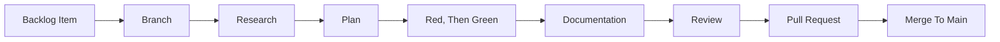

# AI Harness

The AI setup of this repository. It serves Claude Code only. Every artifact has exactly one home.

## Layout

| Artifact          | Path                                     |
| :---------------- | :--------------------------------------- |
| Instructions      | [`CLAUDE.md`](../../CLAUDE.md)           |
| Path-scoped Rules | `.claude/rules/*.md`                     |
| Agents            | `.claude/agents/*.md`                    |
| Skills            | `.claude/skills/*/SKILL.md`              |
| Permissions       | `.claude/settings.local.json`, untracked |
| MCP Approval      | `.claude/settings.json`                  |
| MCP Servers       | `.mcp.json`                              |

[`CLAUDE.md`](../../CLAUDE.md) is intentionally minimal: behavioral directives only. Project knowledge stays in its documented home and is reached through [`README.md`](../README.md), which [`CLAUDE.md`](../../CLAUDE.md) links. That link is the only always-on hop in the harness.

### Naming

`ai-` prefixes every skill and agent, so repository tooling is distinguishable from Claude Code's built-ins and from anything installed globally. A skill is named `ai-<verb>-<object>` after what invoking it produces. An agent is named `ai-<role>` after what it is, which keeps the two kinds apart in a name.

A skill's directory name and its frontmatter `name` are the same string. A skill whose two names disagree does not load.

---

## Rules

Rules are pointers, not content. Each one names the document to read and nothing else, so a convention exists in exactly one place, and a rule pulls in only the document its own area needs.

| File                                                                   | Applies To                                                      | Points At                                                                                                           |
| :--------------------------------------------------------------------- | :-------------------------------------------------------------- | :------------------------------------------------------------------------------------------------------------------ |
| [`.claude/rules/angular.md`](../../.claude/rules/angular.md)           | `**/*.component.ts`, `**/*.component.html`, `**/*.directive.ts` | [`impl/angular.md`](angular.md), [`impl/a11y.md`](a11y.md), [`impl/ubiquitous-language.md`](ubiquitous-language.md) |
| [`.claude/rules/dependencies.md`](../../.claude/rules/dependencies.md) | `package.json`, `.mcp.json`, `renovate.json`                    | [`impl/renovate.md`](renovate.md)                                                                                   |
| [`.claude/rules/markdown.md`](../../.claude/rules/markdown.md)         | `**/*.md`                                                       | [`impl/documentation.md`](documentation.md)                                                                         |
| [`.claude/rules/repository.md`](../../.claude/rules/repository.md)     | Everything                                                      | Invariants, stated inline                                                                                           |
| [`.claude/rules/testing.md`](../../.claude/rules/testing.md)           | `**/*.spec.ts`                                                  | [`impl/testing.md`](testing.md)                                                                                     |

Scoping uses `paths` frontmatter. A rule without `paths` loads in every session, so [`.claude/rules/repository.md`](../../.claude/rules/repository.md) stays short.

[`.claude/rules/angular.md`](../../.claude/rules/angular.md) matches by file suffix rather than by directory, because the Angular workspace does not exist yet, see **Angular UI** in [`impl/backlog.md`](backlog.md). Its globs narrow to the workspace once it does.

---

## Using The Tooling

Only the manual tooling needs instruction. The automatic skills and the agents are selected from their `description`, so documenting when to trigger them would duplicate the frontmatter.

| Invoke          | When                           | Produces                             |
| :-------------- | :----------------------------- | :----------------------------------- |
| `/ai-drive-sdd` | Development begins on a branch | `.research/` then `.plan/` artifacts |
| `/ai-create-pr` | The Definition of Done is met  | One pull request                     |

Each of these has an outward-facing effect, so each is marked `disable-model-invocation` and runs only when invoked. An agent does not decide to open a pull request.

MCP servers are not invoked. Their tools are model-invoked, so there is nothing manual about them beyond the configuration below.

## Agents

| Agent          | Input                                                       | Effort  | Output                                     |
| :------------- | :---------------------------------------------------------- | :-----: | :----------------------------------------- |
| `ai-research`  | Requirement, repository, [`impl/backlog.md`](backlog.md)    | Inherit | `.research/<slug>.md`                      |
| `ai-plan`      | `.research/<slug>.md`                                       | Inherit | `.plan/<slug>.md`                          |
| `ai-implement` | `.plan/<slug>.md`                                           | Inherit | Source code, progress appended to the plan |
| `ai-review`    | Diff, [`impl/definition-of-done.md`](definition-of-done.md) |  High   | Findings                                   |

An agent body stands alone and never assumes who invoked it.

`ai-research` and `ai-plan` declare a `tools` list without `Edit` and `Bash`, because producing no code is the point of those phases; `Write` serves their artifact only. No agent declares a `model`, so each inherits the session model. `ai-review` declares `effort: high`, because catching a Definition of Done violation benefits from more reasoning. An agent's `effort` is part of its own definition, so the override applies on every invocation rather than only the current turn.

## Skills

| Skill                    | Invocation | Effort  | Purpose                                                      |
| :----------------------- | :--------: | :-----: | :----------------------------------------------------------- |
| `ai-create-component`    |    Auto    | Inherit | Place and scaffold an Angular component                      |
| `ai-create-handoff`      |    Auto    |   Low   | Compress a plan for a fresh context                          |
| `ai-grill-plan`          |    Auto    |  High   | Interrogate a plan for gaps                                  |
| `ai-research-issue`      |    Auto    | Inherit | Research a backlog item and emit an external research prompt |
| `ai-review-change`       |    Auto    |  High   | Review a diff against the Definition of Done and run gates   |
| `ai-write-documentation` |    Auto    | Inherit | Apply the documentation guidelines                           |
| `ai-drive-sdd`           |   Manual   | Inherit | Own the SDD templates and drive the phases                   |
| `ai-create-pr`           |   Manual   |   Low   | Open a pull request from a template                          |

`effort` overrides the session's reasoning effort for the skill's own turn only, resuming the session value on the next prompt. `Low` marks mechanical, template-driven skills; `High` marks skills whose entire purpose is finding gaps or defects.

The templates of `ai-create-component` are TypeScript, HTML and SCSS outside any `tsconfig.json`, so `eslint.config.js` ignores `.claude/**`. Prettier and the Markdown gate still cover the directory.

---

## Development Workflow

The harness supports Spec Driven Development. Each phase reads the previous phase's artifact from disk rather than from the conversation, so any phase can be resumed in a fresh session.

There is no issue tracker. [`impl/backlog.md`](backlog.md) is the single source of truth for work items. A defect found in use becomes a backlog item and follows the same flow; `main` is the only release branch.

| Step            | Input                 | Output                                                                         | Tooling                                             |
| :-------------- | :-------------------- | :----------------------------------------------------------------------------- | :-------------------------------------------------- |
| Branch          | Backlog item          | `feature/*` branch, see [`impl/worktrees.md`](worktrees.md) for a parallel one | `git switch -c`, `npm run worktree:add`             |
| Research        | Backlog item          | `.research/<slug>.md`                                                          | `/ai-drive-sdd`, `ai-research`, `ai-research-issue` |
| Plan            | `.research/<slug>.md` | `.plan/<slug>.md` with the approved cases, see [`impl/testing.md`](testing.md) | `ai-plan`, `ai-grill-plan`, `ai-create-handoff`     |
| Red, Then Green | `.plan/<slug>.md`     | Failing specs, then code, progress appended to the plan                        | `ai-implement`, `ai-create-component`               |
| Documentation   | Source code           | Documentation                                                                  | `ai-write-documentation`                            |
| Review          | Diff                  | Findings against [`impl/definition-of-done.md`](definition-of-done.md)         | `ai-review`, `ai-review-change`                     |
| Pull Request    | Verified change       | Pull request                                                                   | `/ai-create-pr`                                     |

`.research/` and `.plan/` are untracked and excluded from the Markdown gate. Implementation progress is appended to the plan file rather than written to a third artifact, so a work item has exactly two files. Templates live in `.claude/skills/ai-drive-sdd/`.

A small task skips the artifacts: edit directly and run `ai-review-change`. **Test First** in [`impl/testing.md`](testing.md#test-first) still applies.

---

## Hooks

None. Verification is the explicit [`ai-review-change`](../../.claude/skills/ai-review-change/SKILL.md) skill, which runs the gates in [`impl/definition-of-done.md`](definition-of-done.md) and reads their output before a change is called done. A hook could force the mechanical checks but cannot judge whether a document is meaningful, which is most of what the Definition of Done asks for.

## Formatting And Linting Discipline

- **No Unrelated Churn**: Do not reformat files unrelated to the task.
- **Existing Commands**: Prefer the existing formatter and linter commands over ad-hoc invocations.
- **Touched Files Only**: Prefer touched-file formatting. If a check fails, fix only the relevant files.
- **Before Done**: Run the format and lint checks before claiming done when code changed.
- **Never Edit Generated**: `dist/` and the files under `test/fixtures/` are never hand-edited.

## Permissions

The repository is public, so it imposes no permissions on a contributor's machine. The committed `.claude/settings.json` holds only `enabledMcpjsonServers`, which approves the servers in `.mcp.json`. Permissions are personal and live in `.claude/settings.local.json`, which is untracked.

The recommended baseline denies what must stay manual. `deny` outranks `allow`, so no allow rule re-enables these:

| Deny                                                        | Reason                                 |
| :---------------------------------------------------------- | :------------------------------------- |
| `git commit/push/merge/rebase/reset/revert/cherry-pick/tag` | History and remote changes stay manual |
| `git clean`, `git filter-branch`, `rm -rf`, `sudo`          | Irreversible                           |
| `gh pr merge`, `gh release`, `npm publish`                  | Outward facing                         |
| `Edit` on `dist/`, `test/fixtures/`, `example/runs/`        | Generated, never hand-edited           |

- **Match On The Command String**: a `Bash` rule matches what is typed, not what runs.
- **Allow Rules Are Personal**: anything not allowed prompts. The allow list is a guardrail against routine mistakes, not a sandbox.
- **Push Stays Manual**: `ai-create-pr` drafts and shows the request, then stops and asks for the push, whatever the allow list says.

---

## MCP Servers

`.mcp.json` in the repository root is the single source. The steps a machine needs before a server connects are in **AI Tooling** of [`CONTRIBUTING.md`](../../CONTRIBUTING.md#ai-tooling).

| Server        | Transport | Purpose                                                        | Authenticates With |
| :------------ | :-------: | :------------------------------------------------------------- | :----------------- |
| `context7`    |  `stdio`  | Library documentation for a named dependency                   | API key, optional  |
| `playwright`  |  `stdio`  | Browser automation against a running studio                    | Nothing            |
| `ux-patterns` |  `http`   | UX pattern guidance and accessibility review for UI components | Nothing            |

`playwright` runs headless and isolated, so it never touches a real browser profile. It is a client and never starts or stops a server: reuse whatever is already listening on the studio's port, and ask rather than starting one. That contract is stated in [`.claude/rules/repository.md`](../../.claude/rules/repository.md), because the risk applies to every task.

`context7` reads its key as `${CONTEXT7_API_KEY:-}`, which Claude Code expands to empty when the variable is unset, so the server starts without a key, at a lower rate limit and without a warning.

The `npx` servers run the exact version pinned in `.mcp.json`, never `@latest`, so a server only changes when its pin is bumped. Renovate proposes those bumps, see [`impl/renovate.md`](renovate.md). `playwright` drives the Chromium build of the Playwright it brings, separate from the one the pipeline uses.

`ux-patterns` is hosted, so nothing runs locally and nothing is pinned. It reviews a component for accessibility, see **Verification** in [`impl/a11y.md`](a11y.md#verification).
