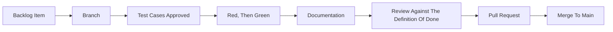

# AI Harness

The AI setup of this repository. It serves Claude Code only. Every artifact has exactly one home.

## Layout

| Artifact          | Path                                     |
| :---------------- | :--------------------------------------- |
| Instructions      | [`CLAUDE.md`](../../CLAUDE.md)           |
| Path-scoped Rules | `.claude/rules/*.md`                     |
| Permissions       | `.claude/settings.local.json`, untracked |
| MCP Approval      | `.claude/settings.json`                  |
| MCP Servers       | `.mcp.json`                              |

[`CLAUDE.md`](../../CLAUDE.md) is intentionally minimal: behavioral directives only. Project knowledge stays in its documented home and is reached through [`README.md`](../README.md), which [`CLAUDE.md`](../../CLAUDE.md) links. That link is the only always-on hop in the harness.

There are no agents and no skills yet. They arrive with the first item that needs one, named `ai-<verb>-<object>` for a skill and `ai-<role>` for an agent, so repository tooling stays distinguishable from Claude Code's built-ins.

---

## Rules

Rules are pointers, not content. Each one names the document to read and nothing else, so a convention exists in exactly one place, and a rule pulls in only the document its own area needs.

| File                                                               | Applies To     | Points At                                   |
| :----------------------------------------------------------------- | :------------- | :------------------------------------------ |
| [`.claude/rules/markdown.md`](../../.claude/rules/markdown.md)     | `**/*.md`      | [`impl/documentation.md`](documentation.md) |
| [`.claude/rules/repository.md`](../../.claude/rules/repository.md) | Everything     | Invariants, stated inline                   |
| [`.claude/rules/testing.md`](../../.claude/rules/testing.md)       | `**/*.spec.ts` | [`impl/testing.md`](testing.md)             |

Scoping uses `paths` frontmatter. A rule without `paths` loads in every session, so [`.claude/rules/repository.md`](../../.claude/rules/repository.md) stays short.

---

## Development Workflow

There is no issue tracker. [`impl/backlog.md`](backlog.md) is the single source of truth for work items.

| Step          | Input              | Output                                                                 |
| :------------ | :----------------- | :--------------------------------------------------------------------- |
| Branch        | Backlog item       | `feature/*` branch                                                     |
| Test Cases    | Backlog item, docs | Approved case tables, see [`impl/testing.md`](testing.md)              |
| Develop       | Approved cases     | Failing specs, then code                                               |
| Documentation | Source code        | Documentation                                                          |
| Review        | Diff               | Findings against [`impl/definition-of-done.md`](definition-of-done.md) |
| Pull Request  | Verified change    | Pull request                                                           |

---

## Hooks

None. Verification is deliberate: the gates in [`impl/definition-of-done.md`](definition-of-done.md) are run and read before a change is called done.

## Formatting And Linting Discipline

- **No Unrelated Churn**: Do not reformat files unrelated to the task.
- **Existing Commands**: Prefer the existing formatter and linter commands over ad-hoc invocations.
- **Touched Files Only**: Prefer touched-file formatting. If a check fails, fix only the relevant files.
- **Before Done**: Run the format and lint checks before claiming done when code changed.
- **Never Edit Generated**: `dist/` and the files under `test/fixtures/` are never hand-edited.

## Permissions

The repository is public, so it imposes no permissions on a contributor's machine. The committed `.claude/settings.json` holds only `enabledMcpjsonServers`, which approves the servers in `.mcp.json`. Permissions are personal and live in `.claude/settings.local.json`, which is untracked.

The recommended baseline denies what must stay manual. `deny` outranks `allow`, so no allow rule re-enables these:

| Deny                                                        | Reason                                 |
| :---------------------------------------------------------- | :------------------------------------- |
| `git commit/push/merge/rebase/reset/revert/cherry-pick/tag` | History and remote changes stay manual |
| `git clean`, `git filter-branch`, `rm -rf`, `sudo`          | Irreversible                           |
| `gh pr merge`, `gh release`, `npm publish`                  | Outward facing                         |

- **Match On The Command String**: a `Bash` rule matches what is typed, not what runs.
- **Allow Rules Are Personal**: anything not allowed prompts. The allow list is a guardrail against routine mistakes, not a sandbox.

---

## MCP Servers

`.mcp.json` in the repository root is the single source.

| Server       | Transport | Purpose                                     | Authenticates With |
| :----------- | :-------: | :------------------------------------------ | :----------------- |
| `playwright` |  `stdio`  | Browser automation against a running studio | Nothing            |

`playwright` runs headless and isolated, so it never touches a real browser profile. It is a client and never starts or stops a server: reuse whatever is already listening on the studio's port, and ask rather than starting one. That contract is stated in [`.claude/rules/repository.md`](../../.claude/rules/repository.md), because the risk applies to every task.

The server runs the exact version pinned in `.mcp.json`, never `@latest`, so it only changes when its pin is bumped. Renovate proposes those bumps through the regex manager in `renovate.json`. It drives the Chromium build of the Playwright it brings, separate from the one the pipeline uses.
