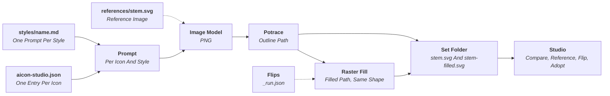
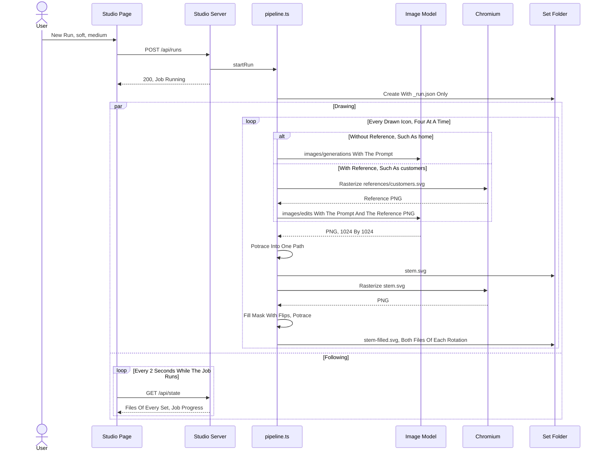

# Pipeline

How a subject becomes two SVG files, what a set records, and the HTTP API between the server and the page. What a project folder holds is in [`user/project-folder.md`](../user/project-folder.md), what the studio does with it in [`user/workflow.md`](../user/workflow.md).

## Files

| File              | Holds                                                                                         |
| :---------------- | :-------------------------------------------------------------------------------------------- |
| `src/cli.ts`      | `aicon-studio [project] [--port]`: resolves the project and serves the studio on the loopback |
| `src/project.ts`  | The folder contract resolved into paths, and `aicon-studio.json` read and written             |
| `src/settings.ts` | The user settings file: location, owner-only mode, the public view without the key            |
| `src/pipeline.ts` | Runs, redraws, refills, the raster fill and describe                                          |
| `src/server.ts`   | The HTTP server: the guard, the page, the files and the JSON API                              |
| `studio/`         | The page, an Angular application built to `dist/studio/browser`, which talks to the API only  |

The API is the seam: the page knows the server through it alone. Its conventions are in [`impl/angular.md`](../impl/angular.md).

---

## Generation

- **Prompt**: the style file whole, `{subject}` replaced by the icon's subject. A referenced icon's prompt ends with `REFERENCE_PROMPT`, which asks to keep the composition of the attached image.
- **Request**: `images/generations` with the prompt, or `images/edits` with the prompt and the reference rasterized to a PNG. Both ask for one 1024 by 1024 PNG with a transparent background, at the run's quality.
- **Drawing**: only outlines are drawn. Each is one image, traced by potrace into one path in a square `viewBox` with 2 of 24 units of padding on every side. The path carries no `fill`, `stroke`, `width` or `height`.
- **Concurrency**: four icons at a time, through one Chromium.
- **Failures**: a request is tried five times on network errors, rate limits, server errors and safety-filter blocks. A rate limit waits as long as its `retry-after` asks, a minute when it names none. Any other client error fails at once. An icon that is never drawn has no file in the set and is listed in `failed`; a failed redraw keeps the last drawing.

### Example Run

A run of the style `soft` at `medium` quality. `home` has no reference, `customers` has one, and `chevron-right` has three rotations as entries of their own.

| When                      | `runs/<run>/soft/` Holds                                                                           |
| :------------------------ | :------------------------------------------------------------------------------------------------- |
| **Start Run**             | `_run.json` only                                                                                   |
| `home` Drawn              | Also `home.svg` and `home-filled.svg`                                                              |
| `chevron-right` Drawn     | Also `chevron-right.svg`, `chevron-right-filled.svg` and both files of each of its three rotations |
| `search` Fails Five Times | No file for `search`; `failed` in `_run.json` lists it                                             |
| **Flip** On `home`        | `home-filled.svg` derived again; `flips` in `_run.json` holds the point                            |
| **Redraw** Of `search`    | Also `search.svg` and `search-filled.svg`; `failed` no longer lists it                             |

---

## Raster Fill

The filled version of an icon is computed from its outline, not drawn. The outline is rasterized to 1024 pixels in Chromium and filled pixel by pixel, then traced back into the `viewBox` of the outline, so outline and fill have the same silhouette.

1. **Bridge**: gaps in the ink of up to 24 of 1024 pixels are closed, so a small break in a brush line still encloses its shape.
2. **Silhouette**: everything not reachable from the border of the canvas is filled.
3. **Interior Lines**: ink lying deeper inside the silhouette than 1.5 stroke widths turns white, so detail lines and dots show as white lines, even where they touch the contour. The stroke width is twice the half-width reached by the thicker strokes, read at the ridges of the ink.
4. **Flips**: each flip switches one region between filled and white. A region is an enclosed area or an interior line. The contour never flips.

An outline whose contour is open wider than the bridge encloses nothing and fills only partly; the log says so. Whether an enclosed area is body or background is a matter of meaning and needs a flip.

---

## Set Record

Every set is a folder `runs/<yyyy-mm-dd-hhmm>/<style>/`. A run creates it with `_run.json` only, and adds the outline `<stem>.svg` and the fill `<stem>-filled.svg` of each icon as soon as it is drawn.

| `_run.json` Field | Holds                                                                         |
| :---------------- | :---------------------------------------------------------------------------- |
| `run`, `style`    | The run and the style of the set                                              |
| `imageModel`      | The image model the set was drawn with, from the settings at the time         |
| `quality`         | `low`, `medium` or `high`                                                     |
| `prompt`          | The style prompt at the time of the run; a redraw uses it, not the style file |
| `icons`           | The `stem` and `subject` of every drawn icon, and whether it was `referenced` |
| `failed`          | The stems that were never drawn; they have no file in the set                 |
| `flips`           | Per stem, the points in `viewBox` units whose fill region is flipped          |

A redraw clears the flips of that icon, because they point at regions of the old drawing.

---

## HTTP API

The server listens on the loopback interface only. Every answer is JSON; a failed check answers `400` with `{ "error" }`, a busy server `409`, a refused request `403`.

| Route                            | Does                                                                                                                                                     |
| :------------------------------- | :------------------------------------------------------------------------------------------------------------------------------------------------------- |
| `GET /`                          | The page, `index.html` of the built page folder                                                                                                          |
| `GET /<file>`                    | A file of the built page folder, such as its script and stylesheet; one path segment with an extension                                                   |
| `GET /files/icons/<f>`           | A file of the target; `/files/sets/<run>/<style>/<f>` and `/files/references/<f>` likewise                                                               |
| `GET /api/state`                 | The project folder, the config, the target, the styles, the files of the target, the references and every set, the public settings and the job           |
| `PUT /api/project`               | Switches every route to another project folder, given as an absolute path; refused while a job runs                                                      |
| `POST /api/pick-folder`          | Opens the folder picker of the operating system and answers the chosen folder, `null` when it is cancelled                                               |
| `PUT /api/settings`              | Stores the settings; an empty key keeps the stored one, absent prices clear them                                                                         |
| `PUT /api/styles/<name>`         | Writes a style; the prompt needs `{subject}` and a `#` heading                                                                                           |
| `DELETE /api/styles/<name>`      | Deletes a style                                                                                                                                          |
| `PUT /api/subjects/<stem>`       | Writes a drawn icon's subject into `aicon-studio.json`                                                                                                   |
| `POST /api/icons`                | Appends an icon: a new stem with a subject, or with `from` a drawn icon and `rotate` 90, 180 or 270, whose files it writes into every set holding `from` |
| `DELETE /api/icons/<stem>`       | Removes an icon and its reference; refused while rotations come from it. Sets and target keep their files                                                |
| `PUT /api/icons`                 | Writes the icons in the `order` given, which names every stem once                                                                                       |
| `PUT /api/references/<stem>`     | Copies the stem's outline of a column, `icons` or a set, as its reference                                                                                |
| `DELETE /api/references/<stem>`  | Removes the reference                                                                                                                                    |
| `POST /api/runs`                 | Starts a run of known styles at a quality, of every drawn icon or of the drawn `stems` given; needs complete settings                                    |
| `POST /api/stop`                 | Stops the running job: no further request starts or is tried again; a drawing whose request is answered is still written                                 |
| `POST /api/redraw`               | Redraws stems of a set                                                                                                                                   |
| `POST /api/describe`             | Writes a subject from a drawing with the describe model                                                                                                  |
| `PUT /api/flips`                 | Stores the flips of a stem in a set and derives its fill                                                                                                 |
| `DELETE /api/sets/<run>/<style>` | Deletes a set, and its run folder when empty                                                                                                             |
| `POST /api/adopt`                | Copies every SVG file of a set into the target, creating it when missing                                                                                 |

- **Files**: an icon URL carries its file's modification time, so a changed file is a new URL and the files are served immutable.
- **One Job**: a run or redraw runs in the background; a second one, a flip, a delete, an adopt or a change to the icons while it runs answers `409`. The page polls the state every two seconds while a job runs.
- **Stop**: the job keeps `running` until its requests in flight are answered, with `stopped` set. A stopped icon is neither drawn nor listed in `failed`, so the set lacks its files.
- **Project**: the server holds one project at a time; `PUT /api/project` replaces it and forgets the finished job. The page keeps the recently opened folders itself. The folder picker is `osascript` on macOS, hosted by Finder so that the dialog opens in front and the browser comes back afterwards, `zenity` on Linux and a PowerShell `FolderBrowserDialog` on Windows; a platform without one answers `400`, a picker that fails `500` with its message.

### Guard

A page on another origin can send a simple cross-origin `POST`, and a DNS name rebound to `127.0.0.1` can reach the server from any site. Three checks refuse both with `403` before any route runs:

| Check          | Rule                                                                                                                 |
| :------------- | :------------------------------------------------------------------------------------------------------------------- |
| `Host`         | `127.0.0.1:<port>` or `localhost:<port>`, the port the server is bound to                                            |
| `Origin`       | Absent, or `http://<host>`, on every request but `GET`                                                               |
| `Content-Type` | `application/json` on every request but `GET`, which a form cannot send without a preflight the server never answers |

The page sends the JSON content type on every write for that reason.
